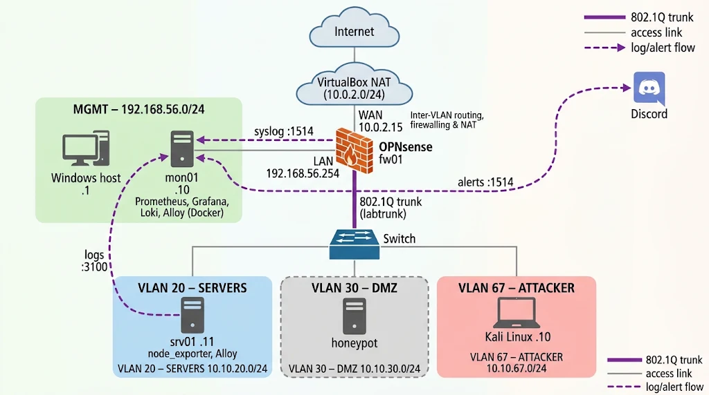
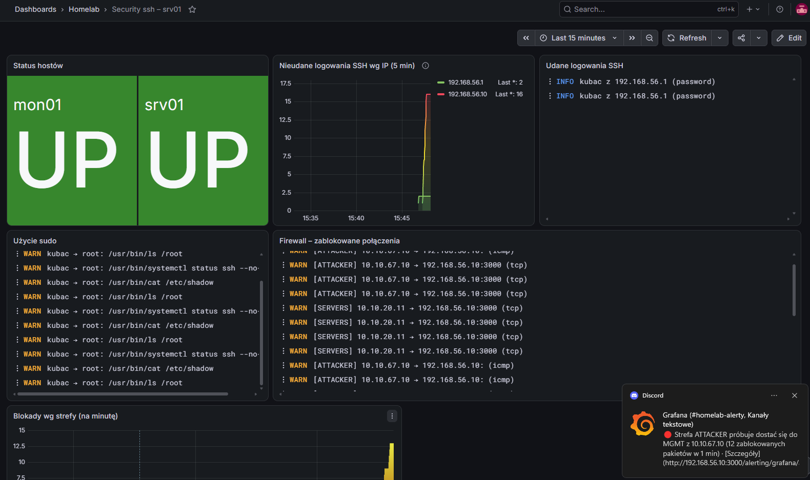
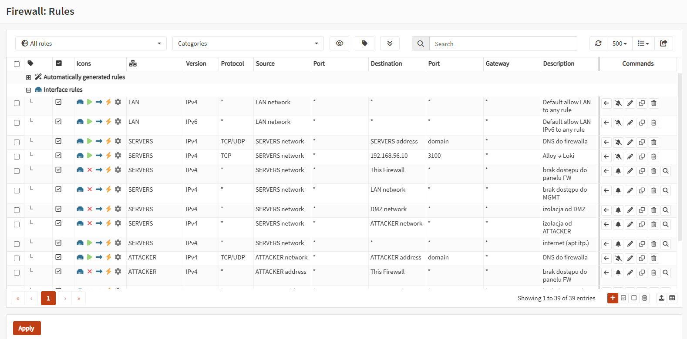

# Home Lab

My self-hosted lab for learning network security and monitoring, running on VirtualBox VMs.
An OPNsense firewall routes and filters all traffic between a management network and three 802.1Q VLANs: SERVERS, DMZ and ATTACKER.
`mon01` runs Prometheus, Grafana, Loki and Alloy in Docker. It collects host metrics, system logs from `srv01` and firewall logs from OPNsense over syslog.
Grafana alerts go to Discord: host down, SSH brute force and any traffic from the ATTACKER VLAN towards the management network.
`sec01` runs Wazuh (SIEM/XDR). Agents on `srv01` and the firewall send host events and Suricata IDS alerts, mapped to MITRE ATT&CK.
A Kali VM in the ATTACKER VLAN is used to run attacks against the lab and check what the firewall, the IDS and the monitoring actually catch.
Dashboards, alert rules and data sources are provisioned from files in this repo, with secrets kept in `.env`.

## Screenshots

**Security dashboard** – host status, SSH logins, sudo usage and firewall blocks per zone.

**OPNsense firewall rules** – default deny between zones, only the traffic each zone needs is allowed.

## Write-ups

- [Wazuh + Suricata](docs/wazuh-suricata.md) – host and network detection, setup and lessons learned

  
   
  
  
  
  
  
   
  
  
  
  

